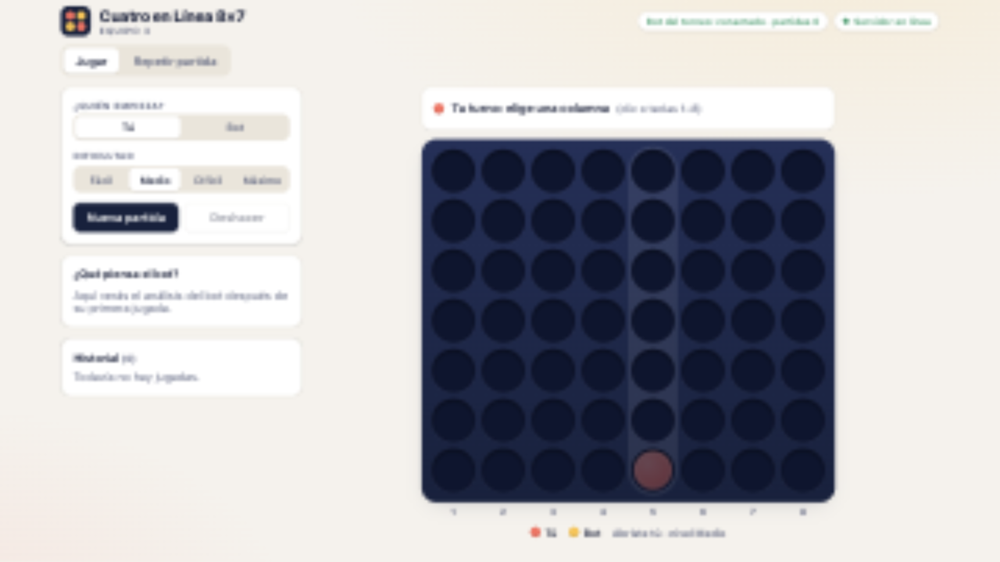
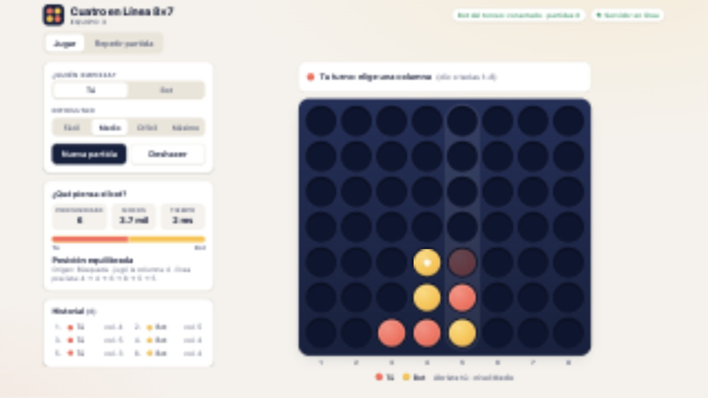
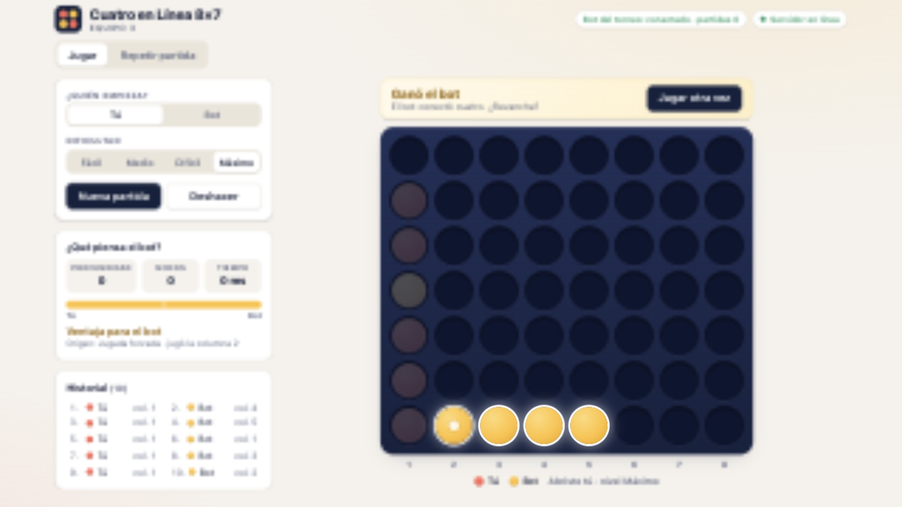
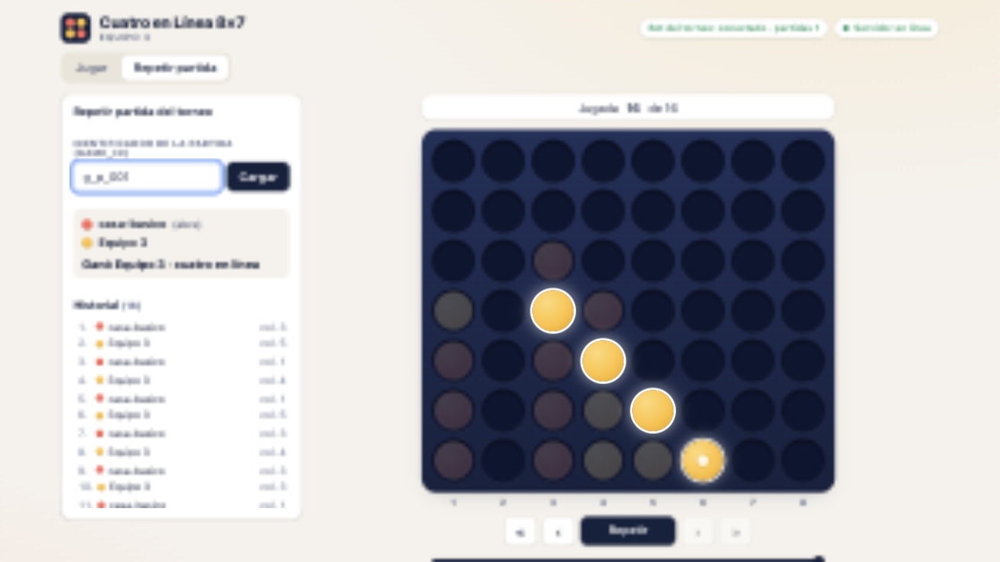

# Manual de uso: Cuatro en Línea 8×7

Este manual es para cualquier persona, aunque nunca haya programado. Explica cómo abrir el juego,
cómo jugar contra nuestro bot y qué significa cada cosa que ves en la pantalla.

---

## 1. ¿Qué es?

Es el clásico **Cuatro en línea**, pero con un tablero un poco más ancho: **8 columnas y 7 filas**.
Juegas contra un programa (el "bot") que piensa sus jugadas. Es el mismo bot que nuestro equipo
inscribió en el torneo.

**Objetivo:** ser el primero en juntar **cuatro fichas de tu color seguidas**, en horizontal (—),
en vertical (|) o en diagonal (/ o \\). Si el tablero se llena y nadie lo logró, es **empate**.

**Cómo se juega:** en tu turno eliges una columna y tu ficha **cae hasta el espacio libre más bajo**
de esa columna. Luego juega el bot. Se turnan hasta que alguien gana o se llena el tablero.

---

## 2. Cómo abrir el juego

Alguien del equipo debe tener encendido el programa en su computadora (ver el `README.md`, comando
`npm start`). Cuando está encendido:

- **En la misma computadora:** abre el navegador (Chrome, Edge, Safari o Firefox) y entra a
  **http://localhost:8787**
- **Desde otro equipo o tu teléfono, en la misma red Wi-Fi:** la persona que encendió el programa ve
  en su pantalla una dirección parecida a `http://192.168.1.29:8787`. Escríbela en el navegador
  del teléfono.

Si ves un aviso de **"servidor desconectado"**, el programa no está encendido: pide que lo enciendan
y pulsa **Reintentar**.

---

## 3. La pantalla, parte por parte

| Elemento | Dónde está | Qué significa |
|---|---|---|
| **Título y "Equipo 3"** | Arriba a la izquierda | El nombre del juego y de nuestro equipo. |
| **Servidor en línea** (verde) | Arriba a la derecha | El juego está conectado con el bot. Si se pone rojo, el bot no responde. |
| **Bot del torneo** | Arriba a la derecha | Sólo informativo: indica si el bot está conectado al torneo oficial y cuántas partidas ha jugado allí. |
| **Pestañas "Jugar" y "Repetir partida"** | Debajo del título | "Jugar" es para jugar tú. "Repetir partida" sirve para ver partidas del torneo. |
| **¿Quién empieza?** | Panel izquierdo | Elige si abres tú o el bot. |
| **Dificultad** | Panel izquierdo | Qué tan fuerte juega el bot (ver sección 5). |
| **Nueva partida** | Panel izquierdo | Borra el tablero y empieza otra vez. |
| **Deshacer** | Panel izquierdo | Quita tu última jugada (y la respuesta del bot) para que lo intentes de nuevo. |
| **Barra de estado** | Encima del tablero | Te dice qué está pasando: si es tu turno, si el bot está pensando o quién ganó. |
| **Tablero azul** | Centro | Las 56 casillas. Los números 1 al 8 debajo identifican cada columna. |
| **Tus fichas** | — | Color **coral (rojo suave)**. |
| **Fichas del bot** | — | Color **ámbar (amarillo)**. |

---

## 4. Jugar una partida paso a paso

1. En **¿Quién empieza?** elige **Tú** o **Bot**.
2. En **Dificultad** elige el nivel (si es tu primera vez, prueba **Fácil**).
3. Pulsa **Nueva partida**.
4. Cuando la barra diga **"Tu turno: elige una columna"**, haz clic (o toca en el teléfono) en
   cualquier parte de la columna donde quieras soltar tu ficha. Al pasar el mouse por encima verás
   una ficha "fantasma" que te muestra dónde caería.
   - Atajo con teclado: las teclas **1 a 8** sueltan la ficha en esa columna.
5. La barra dirá **"El bot está pensando…"** y en un momento caerá su ficha.
6. Repite hasta que alguien gane o se llene el tablero.

### ¿Y si elijo una columna llena?

No pasa nada malo: la columna **tiembla** y aparece un aviso breve diciendo que está llena. Tu turno
sigue; elige otra columna. Las columnas llenas se ven más apagadas.

### Fin de la partida

- **¡Ganaste!** o **Ganó el bot**: las **cuatro fichas ganadoras se iluminan** y el resto del
  tablero se atenúa para que veas la línea.
- **Empate**: el tablero se llenó sin ganador.
- Pulsa **Jugar otra vez** para empezar una nueva partida con las mismas opciones.

---

## 5. Niveles de dificultad

| Nivel | Cómo juega el bot |
|---|---|
| **Fácil** | Piensa muy poco y a veces elige una jugada al azar. Ideal para aprender. |
| **Medio** | Piensa unas pocas jugadas hacia adelante. Ya no deja pasar cosas obvias. |
| **Difícil** | Piensa alrededor de un segundo. Es un rival serio. |
| **Máximo** | Exactamente como juega en el torneo (hasta un segundo y medio por jugada). |

---

## 6. El panel "¿Qué piensa el bot?"

Después de cada jugada del bot verás:

| Dato | Qué quiere decir, en palabras simples |
|---|---|
| **Profundidad** | Cuántas jugadas hacia adelante (suyas y tuyas) alcanzó a imaginar. |
| **Nodos** | Cuántas posiciones distintas del tablero revisó. |
| **Tiempo** | Cuánto tardó en decidir. |
| **Barra de ventaja** | Hacia la izquierda (coral) vas ganando tú; hacia la derecha (ámbar) el bot. En el centro, la partida está pareja. |
| **Mensaje** | Por ejemplo "Posición equilibrada", "Ventaja para el bot" o "El bot ve victoria forzada", que significa que encontró una forma segura de ganar hagas lo que hagas. |
| **Línea prevista** | Las columnas que el bot cree que se jugarán a continuación. |
| **Origen** | "Búsqueda" = lo pensó; "Jugada forzada" = sólo tenía una jugada razonable (por ejemplo, ganar ya o bloquearte). |

El **Historial** debajo muestra todas las jugadas en orden: número, quién jugó y en qué columna.

---

## 7. Repetir una partida del torneo

1. Abre la pestaña **Repetir partida**.
2. Escribe el identificador de la partida (lo muestra el tablero oficial del torneo, algo como
   `g_7f3a`) y pulsa **Cargar**.
3. Usa los botones para moverte: **«** al inicio, **‹** una jugada atrás, **Repetir** reproduce
   sola la partida, **›** una jugada adelante, **»** al final.
4. Arriba verás los dos equipos, quién abrió, y el resultado con la línea ganadora resaltada.

---

## 8. Problemas comunes

| Lo que ves | Qué hacer |
|---|---|
| "Servidor desconectado" | El programa del bot está apagado. Pide que lo enciendan y pulsa **Reintentar**. |
| El bot tarda mucho | En nivel Máximo puede tardar hasta 1.5 segundos; es normal. |
| No puedo entrar desde el teléfono | Verifica que el teléfono esté en la **misma red Wi-Fi** y que usas la dirección con números (no "localhost"). |
| "No existe una partida con id…" en Repetir | Revisa que el identificador esté bien escrito y que el torneo esté en línea. |
